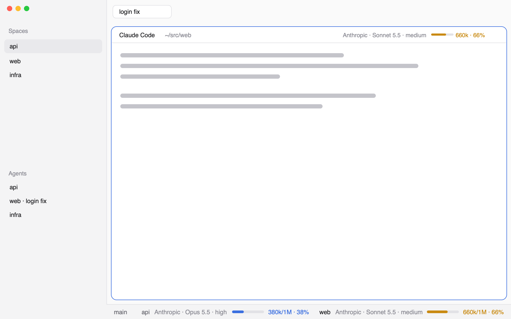

# Herdr Context

Herdr's default window, plus how much context each Claude Code agent has used: a meter in every agent pane's header, a strip of meters in the status bar, and a toast when an agent passes 80%.

## What you see

The layout is a clone of Herdr's `main`. Only two things differ:

- **Status bar** (28px, bottom of the work column): a `row` split 1:2. The left third is the shipped `workspace-status` (machine, branch, agents, palette hint). The right two thirds is the `context` mod: per Claude Code agent, its label, `provider · model · effort`, a 60×5px bar and `118k/1M · 12%`. See `mods/context` in this repo for the full brief.
- **Pane headers** (30px, top of each pane): `pane-context`, a clone of the shipped `pane` header. When the pane runs a Claude Code agent, it adds `Anthropic · Sonnet 5.5 · medium`, a 42×4px bar and `93k · 46%` (11px) on the right, before the status icon.

Bar and text colors: `done` below 60%, `working` from 60%, `blocked` from 80%.

## How it behaves

- Agent status (working, blocked, done, idle) looks as it does in `main`: spinner, "Needs you" pill, done dot. The context meter sits next to it and never replaces it.
- The context values refresh every 5 s, from the agent's Claude Code transcript (on remote machines too).
- Clicking a meter in the status bar runs `agent.focus` on that agent. Clicking a pane header focuses that pane, as in `main`.
- At 80%: one warning toast per agent, which focuses that agent when clicked. It fires again only after the agent drops below 70%.

## Built from

- `layouts/herdr-context.json`: `main`'s tree. The `status` block is replaced by `status-row` (`row`, 28px, `resizable: false`), whose children are `status` (`workspace-status`, weight 1) and `context` (`context`, weight 2). The tab block's `pane.header.content.mod` is `pane-context`. `preview` is `layouts/herdr-context.svg`.
- `mods/context`: reads `~/.claude/projects/<slug>/*.jsonl` with `exec("sh", …, { on: space.machine })`, posts `notify`, and publishes `shared("context.usage")` = `{ address: { used, window, pct, provider, model, effort, fast } }`.
- `mods/pane-context`: the shipped `pane` mod plus `shared` and a `contextChip(theme, usage)` helper. It reads `shared("context.usage")[props().terminal]` and runs nothing itself.
- The shipped mods it uses as they are: `workspace-chrome`, `spaces`, `agents`, `tabs`, `files`, `changes`, `workspace-status`.

## Watch out

- The pane headers only show a meter while the `context` block is in the layout, because it is the one that fills `shared("context.usage")`.
- Both mods carry the same `short()` formatter. Keep them in step if you change one.
- `pane-context` is a frozen copy of Herdr's `pane`. It won't pick up later changes to the shipped header.
- Every limit of `mods/context` applies here too: Claude Code only, the newest transcript per folder wins, and the window comes from a model-id table.

## Done when

- `herdr-app check` passes for `mods/context` and `mods/pane-context`. `layout.switch {"name":"herdr-context"}` shows the window with no `layout.error`.
- A Claude Code pane's header shows `Nk · N%`, and the status bar shows the same number for that agent.
- A shell pane's header shows no meter.
- The status bar's left third still shows `workspace-status`.
