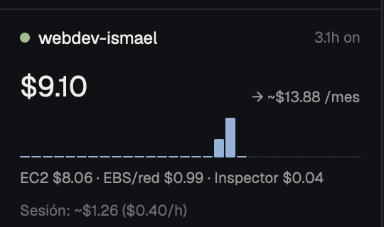

# AWS cost

A small sidebar card that shows what one AWS project has cost this month. Cost Explorer filters by a cost-allocation tag. The card also shows the month's daily bars, the top services, an end-of-month projection, and the live state and running cost of the EC2 instances that carry the same tag.

## What you see

- A block about 160px tall, with a 1px `border` top line, 14px side padding and 10px vertical padding. Text is 12px in `muted`.
- **Header row:**
  - on the left, a 7px dot followed by the label (`props.label`, else the tag value) in `foreground`, semibold;
  - the dot is `ansi2` (green) while any tagged instance is running, `dim` when they are all stopped, and `unknown` before the first answer;
  - on the right, in 10.5px `dim`: `3.1h on` (hours since the longest-running instance launched), or the state (`stopped`), `sin EC2` when no instance has the tag, or `…` while loading.
- **Month to date:** `$9.10` in 20px semibold `foreground`. Right-aligned next to it: `→ ~$13.88 /mes` in 10.5px.
- **Daily bars:** one bar per day of the month, filling the width with 1px gaps. They are 28px tall at most and scaled to the month's highest day. Days with data are `accent`; days still to come are 1px `border` stubs.
- **Top services:** up to three, in 10.5px and truncated: `EC2 $8.06 · EBS/red $0.99 · Inspector $0.04`. Common services have short names: `EC2 - Other` is `EBS/red`.
- **Session line**, only while an instance runs: `Sesión: ~$1.26 ($0.40/h)` in `dim`. It is hours since launch × on-demand price, summed over the running instances.
- **Errors:** the last line of the AWS CLI's stderr, in 10.5px `blocked`, under the rest.
- **Missing config:** without `props.value`, the card shows only `aws-cost: falta props.value (valor del tag)`.

## How it behaves

- **Refresh rates:** instance state refreshes every 2 min, because `describe-instances` is free. Cost Explorer is asked at most every 6 h, because each `get-cost-and-usage` call costs $0.01. Its last answer is kept in `localStorage` and survives reloads. A new month, or a different tag value, asks again.
- **Click to refresh:** clicking anywhere on the card forces both refreshes, Cost Explorer included. The card hovers to `hover`.
- **Cost Explorer lag:** Cost Explorer lags ~24 h, so today's bar is partial. The projection is month-to-date plus the average of the complete days × the days left (today counted as left).
- **Instance prices:** each instance type's price is the on-demand Linux, shared-tenancy price from the Pricing API for `props.region`. It is looked up once per type and cached in `localStorage`. `props.hourly` overrides it for every instance.
- **Agent status:** working, blocked, done and idle have no effect on this mod.

## Built from

- **The mod:** one mod, `mods/aws-cost/`. `mod.json` is `{ "place": "none", "title": "AWS coste" }`, so you place it yourself.
- **Where it sits:** in a cloned `main`, it sits in the `sidebar` column between `sidebar-lists` and `sidebar-footer`:
  `{ "id": "aws-cost", "type": "block", "size": { "px": 160 }, "content": { "mod": "aws-cost", "props": { "value": "my-project" } } }`.
- **Props:**
  - `value` (required): the tag value;
  - `tag` (default `Project`);
  - `region` (default `eu-west-1`);
  - `hourly` (USD/h, skips the Pricing API);
  - `label`;
  - `ignoreCredentialsFile` (default true).
- **AWS calls,** all through `exec("env", ["AWS_SHARED_CREDENTIALS_FILE=/dev/null", "aws", …, "--output", "json"])` with a 60 s timeout:
  - `ec2 describe-instances --filters Name=tag:<tag>,Values=<value> Name=instance-state-name,Values=pending,running,stopping,stopped`;
  - `pricing get-products --region us-east-1 --service-code AmazonEC2`, with TERM_MATCH on instanceType, regionCode, operatingSystem=Linux, tenancy=Shared, preInstalledSw=NA, capacitystatus=Used;
  - `ce get-cost-and-usage --granularity DAILY --metrics UnblendedCost --filter {"Tags":{"Key":tag,"Values":[value]}} --group-by Type=DIMENSION,Key=SERVICE`, from the 1st of the month (UTC) to tomorrow.
- **`herdr` functions:** `exec`, `props`, `theme`, `checking`.
- **What it touches:** it runs a program (`aws`, which reaches the network with the person's AWS credentials). It reads no files outside its folder.

## Watch out

- **Credentials file:** `AWS_SHARED_CREDENTIALS_FILE=/dev/null` is there because a stale `aws_session_token` in `~/.aws/credentials` beats a profile's `credential_process` (IAM Roles Anywhere, SSO helpers) and gives `ExpiredToken`. If your credentials live in that file, set `"ignoreCredentialsFile": false`.
- **Activate the tag:** the tag must be an **active cost-allocation tag** (Billing → Cost allocation tags), or Cost Explorer returns nothing. Spend from before activation is never tagged.
- **IAM permissions:** it needs `ec2:DescribeInstances`, `ce:GetCostAndUsage` and `pricing:GetProducts`.
- **Session cost is an estimate:** it covers compute only, at on-demand Linux prices. It ignores Savings Plans, Spot, Reserved and Windows pricing.
- **UTC days:** dates are UTC, like Cost Explorer's.
- **Checks:** `herdr-app check` runs `init` for real, so `if (checking()) return;` comes before the first AWS call. That way a check costs nothing.
- **Placement:** `place: "none"` matters. Without it, Herdr docks a second copy on the right the first time it sees the folder.

## Done when

- `herdr-app check mods/aws-cost` passes and makes no AWS calls.
- With `props.value` set to an active tag value, the card shows the month-to-date total. It matches Cost Explorer's month-to-date total for that tag.
- The service line matches Cost Explorer grouped by service.
- A running tagged instance turns the dot green and shows `Nh on` and `Sesión: ~$X ($Y/h)`, with `$Y` matching the on-demand price.
- Stopping the instance turns the dot `dim` and shows `stopped` within 2 min.
- Reloading the mod doesn't call Cost Explorer again within 6 h. Clicking the card does.
- Without `props.value` it shows the missing-config line.
