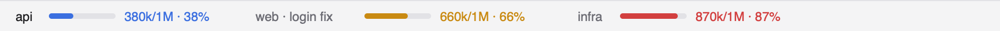

# Context

A slim bar that shows, for each Claude Code agent, its provider, model and effort and how much of its context window it has used, on this computer and on remote machines. When an agent passes 80%, a toast tells you to compact.

## What you see

- A 28px strip, theme `chrome` background, 1px `border` top line, 11.5px text in `muted`.
- One entry per Claude Code agent, left to right in `agents()` order, 18px apart:
  - its label: the space name, plus `· <tab name>` when the tab was named (tabs still called by number show the space name only); `foreground` for the focused agent, `muted` otherwise, truncated at 180px;
  - `Anthropic · Opus 5.5 · medium` in `dim` (provider · model · effort, plus `· fast` in fast mode), truncated at 220px;
  - a 60×5px rounded bar on `border`, filled in `done` below 60%, `working` from 60%, `blocked` from 80%;
  - `118k/1M · 12%` in `dim`, or in `blocked` from 80%.
- With no Claude Code agents: `No Claude Code agents` in `dim`.

## How it behaves

- Refreshes every 5 s. Agent status (working, blocked, done, idle) does not change the look; only the context use does.
- The value is the last finished assistant turn: `input_tokens + cache_read_input_tokens + cache_creation_input_tokens`. It lags during a long turn.
- Context size comes from the transcript line's `message.model`: 1M for `fable`, `mythos`, `opus-5`, `opus-4-6/7/8`, `sonnet-5`, `sonnet-4-6`, `haiku-5`; 200k for anything else (Haiku 4.5, older models), unless usage is already above 200k. `props: { "window": 200000 }` forces a size.
- Click an entry: `agent.focus` on that agent. Hover: `hover` background.
- Crossing 80%: one `notify` with level `warning`, title `Context at N%`, and an action that focuses the agent. It fires again for that agent only after it drops below 70% (for example after `/compact`). Warned agents are kept in the copy's `localStorage`.
- Publishes `shared("context.usage")` = `{ "<address>": { used, window, pct, provider, model, effort, fast } }`, set only when it changes. Other mods can read it. For example, a clone of the shipped `pane` header can draw `Anthropic · Sonnet 5.5 · medium`, a 42px bar and `93k · 46%` for `props().terminal`.

## Built from

- One mod, `mods/context/`. `mod.json` is `{ "place": "bottom", "size": 28 }`. Shipped layouts are read-only, so you can also place it yourself in a cloned layout: replace the `status` block with a `row` of 28px that holds `workspace-status` (weight 1) and `{ "mod": "context" }` (weight 1).
- `herdr` functions it uses: `agents()`, `terminals()`, `panes()`, `spaces()`, `theme()`, `props()`, `run("agent.focus")`, `exec`, `notify`, `setShared`, `checking`.
- It runs `sh` once per agent per refresh, with `on: space.machine`. The script turns the agent's folder into Claude Code's project slug (every non-alphanumeric character becomes `-`). It takes the newest `~/.claude/projects/<slug>/*.jsonl`, walking up to parent folders if none exists. It reads the last 400 lines, and keeps the last line that has `"role":"assistant"` and `"usage"` and is not `<synthetic>`. JSON parsing happens in the mod. From the same line: `message.model` (shown as `Opus 5.5`), `perTurnEffort` or `effort`, `message.usage.speed` (`fast`), and `requestId`.
- It reads files outside its folder (`~/.claude/projects`, on each machine) and runs programs (`sh`, `ls`, `tail`, `grep`, `sed`). It makes no network calls.

## Watch out

- Use `panes()` for the agent's folder. `terminals()[i].cwd` can be the shell's starting folder (`/home/ubuntu`), not where Claude runs.
- Two Claude sessions in the same folder show the same number: the newest transcript wins.
- The transcript names no provider, so the mod guesses it: `Bedrock` for ids with an `anthropic.` prefix or an ARN, `Vertex` for ids with `@`, `Anthropic` for `req_…` request ids, and `?` otherwise. Vertex and Foundry sessions with bare model ids may show as `Anthropic`.
- Claude Code only. Agents whose `app` is not `claude-code` (and whose program key is not `claude`) are skipped.
- The window table is a regex over model ids: a new model family that is not 1M needs adding to it (or a `props.window`).
- `herdr-app check` runs `init` for real: `if (checking()) return;` before starting the timer.
- Mods don't get docked into shipped layouts. If it doesn't appear, place it in a cloned layout.

## Done when

- `herdr-app check mods/context` passes.
- With a Claude Code agent running, the bar shows its label, `Anthropic · <Model> · <effort>`, a bar and `Nk/1M · N%`. The number matches the last `usage` line of its transcript.
- An agent on a remote machine shows its own value.
- Clicking an entry focuses that agent.
- Forcing `props.window` below current usage turns the bar `blocked` and posts one toast per agent. A second refresh posts nothing more.
- `shared("context.usage")` holds every shown agent's `{ used, window, pct }`.
